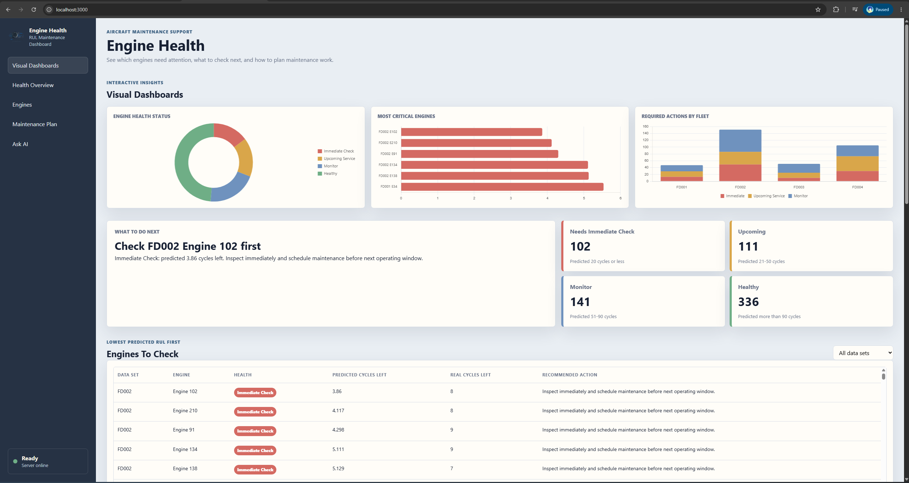
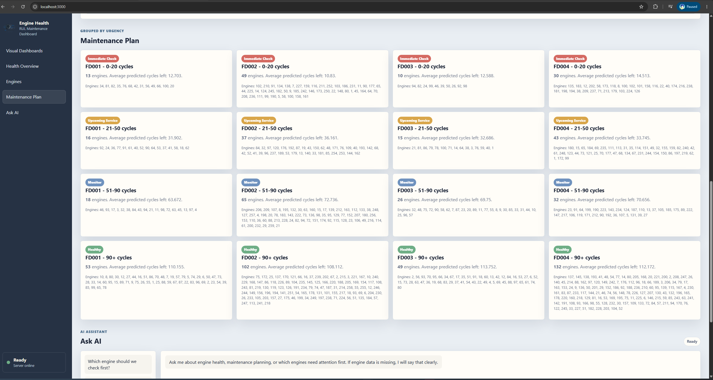
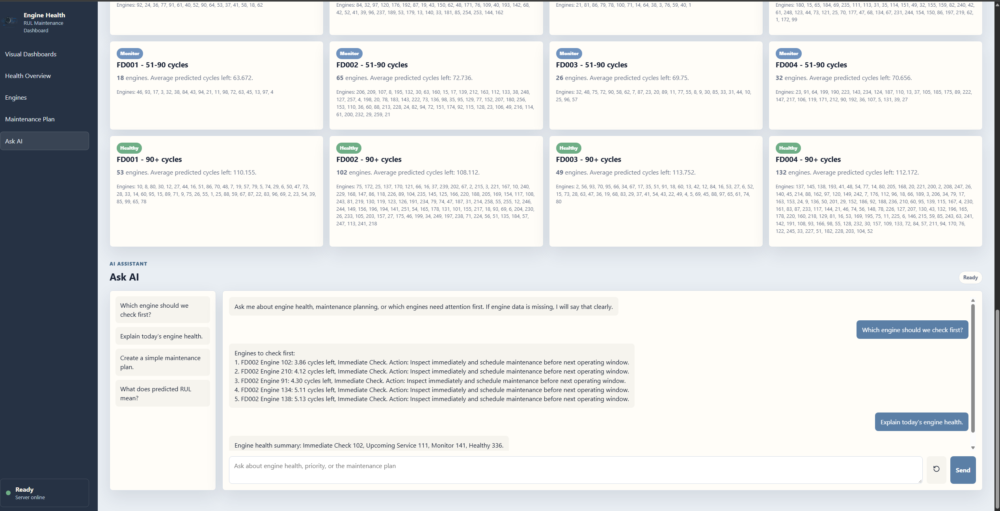

# Aircraft Engine Remaining Useful Life Prediction

**Predictive Maintenance | Machine Learning | Deep Learning | Interactive Dashboard**

An academic predictive-maintenance project that estimates the **Remaining Useful Life (RUL)** of turbofan engines using the NASA **C-MAPSS FD001–FD004** datasets.

The project combines machine learning and deep learning models with an interactive web dashboard for engine health analysis, RUL prediction, maintenance prioritization, and AI-assisted insights.

> **Research demonstration:** This project uses historical simulation data, not live aircraft telemetry. Maintenance recommendations are illustrative and are not certified aviation maintenance instructions.

---

## Project Preview

### 1. Engine Health Dashboard

Interactive dashboard displaying fleet health, critical engines, predicted RUL, and recommended maintenance actions.



### 2. Maintenance Planning

Maintenance recommendations organized by urgency and predicted remaining operating cycles across FD001–FD004.



### 3. AI Maintenance Assistant

An AI-powered assistant that helps users identify high-priority engines, understand fleet health, and review maintenance recommendations.



---

## Project Overview

Aircraft engines generate operational sensor data that can be analyzed to estimate degradation and remaining useful life.

This project uses the NASA C-MAPSS benchmark to develop and evaluate predictive maintenance models.

The solution covers:

- Data preprocessing and feature scaling
- Time-series sequence generation
- Machine learning and deep learning
- Model evaluation and comparison
- Engine-level RUL predictions
- Maintenance priority classification
- Interactive dashboard visualization
- AI-assisted analysis

## Machine Learning Models

Four prediction approaches are implemented and compared.

| Model | Description |
|---|---|
| BiLSTM | Bidirectional Long Short-Term Memory network for sequential sensor data |
| GRU + Attention | Recurrent neural network with an attention mechanism |
| XGBoost | Gradient-boosted prediction using engineered features |
| Ensemble | Average predictions from multiple models |

### BiLSTM

Processes sequential engine sensor observations using a bidirectional recurrent architecture.

### GRU with Attention

Uses a GRU network and attention mechanism to learn temporal patterns in engine degradation data.

### XGBoost

Uses gradient-boosted decision trees for RUL prediction based on engineered input features.

### Ensemble Learning

Combines predictions from multiple models to provide an alternative prediction approach.

---

## Dataset

**NASA C-MAPSS Turbofan Engine Degradation Simulation**

The project supports four benchmark subsets:

- FD001
- FD002
- FD003
- FD004

The dataset contains simulated engine operating conditions, sensor measurements, and degradation sequences.

Raw datasets are not included in this repository.

Place the downloaded files inside the `datasets/` directory:

```text
datasets/
├── train_FD001.txt
├── test_FD001.txt
├── RUL_FD001.txt
├── train_FD002.txt
├── test_FD002.txt
├── RUL_FD002.txt
├── train_FD003.txt
├── test_FD003.txt
├── RUL_FD003.txt
├── train_FD004.txt
├── test_FD004.txt
└── RUL_FD004.txt
```

---

## Model Evaluation

Model performance is evaluated using:

- **MAE:** Mean Absolute Error
- **RMSE:** Root Mean Squared Error

Both metrics are measured in remaining operating cycles. Lower values indicate better predictions.

### Ensemble Test Results

The following results are taken from the repository's saved test-split evaluation results.

| Dataset | Model | MAE | RMSE |
|---|---|---:|---:|
| FD001 | Ensemble (Average) | 10.17 | 14.23 |
| FD002 | Ensemble (Average) | 14.22 | 18.68 |
| FD003 | Ensemble (Average) | 7.40 | 11.99 |
| FD004 | Ensemble (Average) | 11.28 | 17.12 |

Source: [Final Model Results](outputs/final_split_results_all_subsets.csv)

These results represent test-split experiments rather than cross-validation averages.

Additional model comparisons, validation results, and Group K-Fold summaries are available in the `outputs/` directory.

---

## Dashboard Features

The interactive dashboard provides:

- Fleet-level engine health visualization
- Predicted remaining useful life
- Actual RUL values from benchmark data
- Identification of critical engines
- Maintenance priority classification
- Suggested maintenance actions
- Maintenance planning by dataset
- Interactive data filtering
- AI-assisted questions about engine predictions

### Maintenance Priority Levels

| Predicted RUL | Dashboard Classification |
|---|---|
| 0–20 cycles | Immediate Check |
| 21–50 cycles | Upcoming Service |
| 51–90 cycles | Monitor |
| More than 90 cycles | Healthy |

These thresholds are project-defined and intended only for demonstration and decision-support purposes.

---

## AI Maintenance Assistant

The dashboard includes an optional AI assistant integrated through the OpenRouter API.

It can help users:

- Identify engines requiring immediate attention
- Understand current fleet health
- Interpret predicted RUL values
- Review maintenance priorities
- Explore suggested maintenance plans

The assistant uses available project information to support explanations and is not intended to replace engineering expertise.

---

## Technologies Used

| Category | Technologies |
|---|---|
| Programming | Python, JavaScript |
| Deep Learning | PyTorch, BiLSTM, GRU + Attention |
| Machine Learning | XGBoost, Scikit-learn |
| Data Processing | Pandas, NumPy |
| Visualization | Matplotlib, Chart.js |
| Web Development | Node.js, Express.js, HTML, CSS |
| AI Integration | OpenRouter API |
| Development Environment | Jupyter Notebook |

---

## Repository Structure

```text
aircraft-engine-rul-prediction/
│
├── datasets/
│   └── README.md
│
├── outputs/
│   ├── final_all_results.csv
│   ├── final_split_results_all_subsets.csv
│   ├── final_kfold_results_all_subsets.csv
│   ├── engine_predictions_FD001.csv
│   ├── engine_predictions_FD002.csv
│   ├── engine_predictions_FD003.csv
│   ├── engine_predictions_FD004.csv
│   └── ... additional results
│
├── screenshots/
│   ├── engine-health-dashboard.png
│   ├── maintenance-plan.png
│   └── ai-assistant-demo.png
│
├── rul_dashboard_web/
│   ├── public/
│   │   ├── index.html
│   │   ├── style.css
│   │   └── app.js
│   ├── logo.png
│   ├── server.js
│   ├── package.json
│   ├── package-lock.json
│   └── start.cmd
│
├── RUL_Prediction_Framework_FD001_FD004.ipynb
├── rul_prediction.py
├── generate_dashboard_data.py
├── combine_final_results.py
├── aircraft_engine_rul_project_report.pdf
├── requirements.txt
├── .gitignore
└── README.md
```

---

## Getting Started

### 1. Clone the Repository

```bash
git clone https://github.com/bandar-farhan/aircraft-engine-rul-prediction.git
cd aircraft-engine-rul-prediction
```

### 2. Install Python Dependencies

```bash
pip install -r requirements.txt
```

### 3. Prepare the Dataset

Download NASA C-MAPSS FD001–FD004 data and place the files inside the `datasets/` directory.

### 4. Run the Prediction Pipeline

```bash
python rul_prediction.py
```

The training pipeline performs data preprocessing, sequence generation, model training, evaluation, and result export.

Deep learning training may require significant computational resources.

### 5. Generate Dashboard Data

```bash
python generate_dashboard_data.py
```

This script generates engine-level predictions, maintenance priorities, and dashboard-ready outputs.

### 6. Run the Web Dashboard

Navigate to the dashboard directory:

```bash
cd rul_dashboard_web
```

Install Node.js dependencies:

```bash
npm install
```

Start the server:

```bash
npm start
```

Open the dashboard in your browser:

```text
http://localhost:3000
```

The repository includes saved prediction results for exploring the dashboard without retraining every model.

---

## Optional AI Assistant Configuration

To enable external AI functionality, create a `.env` file inside `rul_dashboard_web/`.

```env
OPENROUTER=your_openrouter_api_key_here
PORT=3000
```

A valid OpenRouter API key and internet connection are required for API-dependent features.

**Never upload API keys or `.env` files to GitHub.**

---

## Project Documentation

### Jupyter Notebook

The complete model development and experimentation notebook is available here:

[View Jupyter Notebook](RUL_Prediction_Framework_FD001_FD004.ipynb)

### Graduation Project Report

The full academic report includes the methodology, experiments, analysis, and project documentation.

[View Project Report](aircraft_engine_rul_project_report.pdf)

### Model Results

Saved prediction results and performance metrics are available in:

[View Results Directory](outputs/)

---

## Project Limitations

- NASA C-MAPSS is a simulated benchmark dataset.
- Predictions are not based on live aircraft telemetry.
- Model performance varies by dataset and evaluation method.
- Maintenance thresholds are illustrative rather than operational standards.
- AI-generated explanations are supplementary to the prediction results.

This solution is intended for academic research, experimentation, and demonstration.

---

## Project Team

This project was developed as a graduation project at the University of Jeddah.

- Abdulaziz Alsaidalani
- Omar Daffa
- Ahmed Babader
- Firas Matari
- Bandar Farhan

### Supervisor

Dr. Tariq Alsahfi

---

## Disclaimer

This project is intended for academic and research purposes only.

Predictions and maintenance recommendations should not be interpreted as certified aircraft maintenance decisions.
